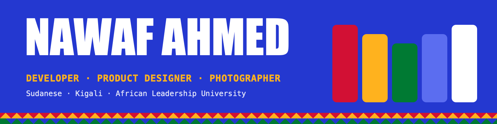

  

<h3 align="center" dir="rtl">أهلاً، أنا نوّاف</h3>

  I'm a Sudanese software engineering student at <a href="https://www.alueducation.com/">African Leadership University</a> in Kigali. 
  I build products people can use when the internet doesn't cooperate, and I care how they look and feel.

  <a href="https://nawaf-ahmed.vercel.app"><b>Portfolio</b></a> ·
  <a href="https://nawaf-ahmed.vercel.app/Nawaf_Ahmed_CV.pdf"><b>CV</b></a> ·
  <a href="https://www.linkedin.com/in/nawaf-ahmed-876101215/"><b>LinkedIn</b></a> ·
  <a href="https://www.instagram.com/nwafawad/"><b>Instagram</b></a> ·
  <a href="mailto:nwafawad49@gmail.com"><b>Email</b></a>

<i>Open to internships and freelance work, in Kigali or remote.</i>

---

### What I'm into

- **Offline-first apps.** Software that keeps working with a weak connection and syncs when it comes back.
- **Full stack with a design eye.** Flutter and Next.js on the front, Express, FastAPI and PostgreSQL behind them.
- **Real users.** Campus tools for my classmates, learning tools for schools, a school portal for families in Kigali.
- **Off screen.** Sudanese and African music, photography, and football.

### Selected projects

| Project | What it is | Built with |
|---|---|---|
| [**CampusCare**](https://github.com/nwafawad/campus_incident_reporter) | Report and track maintenance and safety issues at ALU Kigali. Students add photos, anonymously if they want. Staff triage a queue. | Flutter, Firebase |
| [**Asala Hub**](https://asala-hub.vercel.app) | Offline-first e-learning app. Courses, assignments and grading keep working without internet and sync on reconnect. | Next.js, FastAPI, PostgreSQL, IndexedDB, Docker |
| [**Momentum (Himma)**](https://github.com/nwafawad/himma) | Turns what you read and study into skill paths, with AI insights on your progress and gaps. | Next.js, Express, Prisma, PostgreSQL |
| [**Story Cast**](https://github.com/nwafawad/storycast) | A microsite about Sudanese music, culture and landscapes, with transcripts for every recording. | HTML, Sass |
| [**Elevanda Ventures**](https://github.com/nwafawad/CLIENT_APPLICATION-Elevanda-Ventures) | School management portal for parents and students in Kigali, built during my internship. | React, Node.js, Express |

### Tools I use

**Languages:** Python · TypeScript · JavaScript · Dart · SQL · Bash 
**Front end:** Next.js · React · Flutter · Tailwind CSS · Sass 
**Back end and data:** Node.js · Express · FastAPI · Flask · Django · PostgreSQL · MongoDB · Prisma 
**Infrastructure:** Docker · Nginx · HAProxy · Linux · Git · Vercel 
**Design:** Figma · user research · prototyping · accessibility (WCAG)

---

  Made with love from Sudan · صُنع بحُب من السودان

